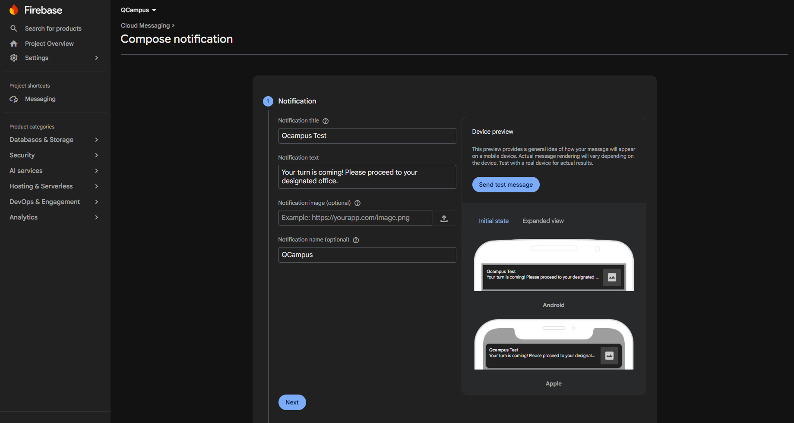
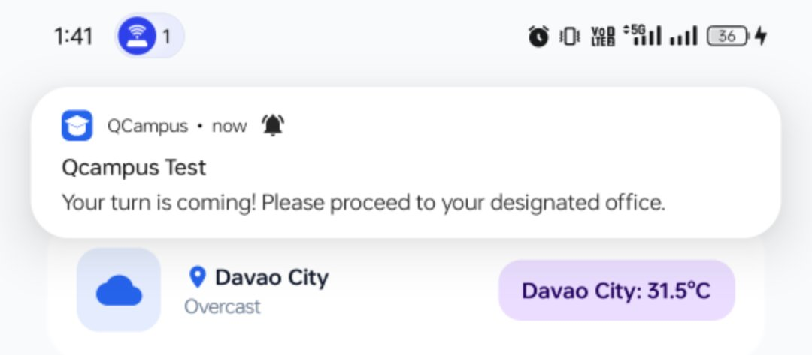
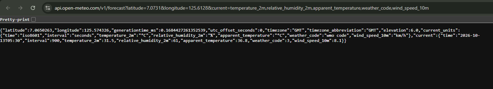
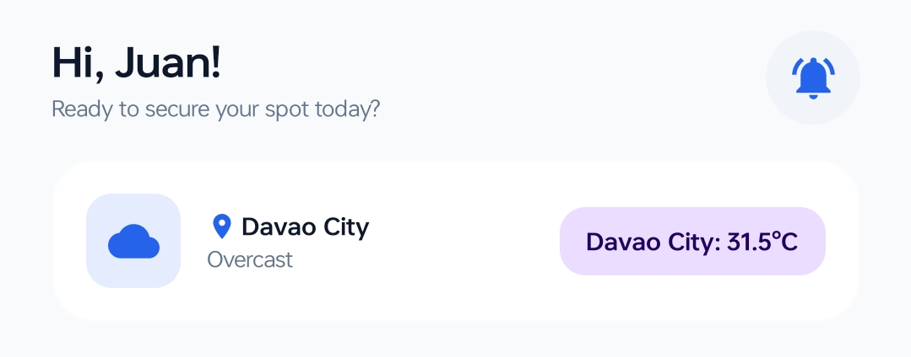
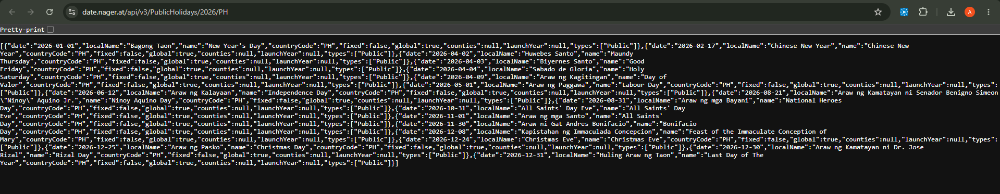
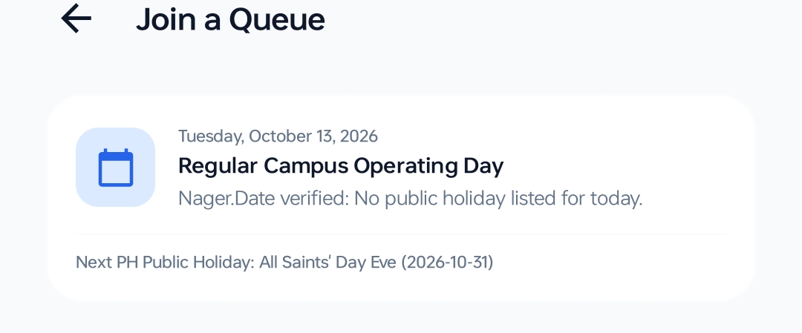

# QCampus — Campus Queue Management System

## Project Description

QCampus is an Android-based campus queue management application designed to make requesting school documents and accessing student services more convenient. It allows students to join virtual queues and monitor their queue status without physically waiting in long lines.

The application supports campus offices such as the Registrar, Accounting, Student Affairs, and Scholarship Office. It also integrates external APIs for weather information and public holiday data, together with Firebase Cloud Messaging for push notifications.

## Key Features

* **Student and Staff Access** — Provides separate access and dashboards for students and authorized staff.
* **Virtual Queue Management** — Allows students to join queues for campus services.
* **Queue Status Monitoring** — Displays the student's current ticket and queue status.
* **Queue History** — Allows students to review previous queue activities.
* **Profile Management** — Displays student information, including the Student ID.
* **Push Notifications** — Integrates Firebase Cloud Messaging (FCM) for notification delivery.
* **Weather Information** — Integrates Open-Meteo API for weather data.
* **Public Holiday Information** — Integrates Nager.Date API for public holiday data.
* **Office-Specific Queue Prefixes** — Uses the following ticket prefixes:

    * Registrar: `R-00`
    * Accounting: `A-00`
    * Student Affairs: `SA-00`
    * Scholarship: `S-00`
* **Logout Confirmation** — Asks users to confirm before logging out.

## Technologies Used

| Technology               | Purpose                               |
| ------------------------ | ------------------------------------- |
| Kotlin                   | Android application development       |
| Android Studio           | Development environment               |
| Jetpack Compose          | User interface development            |
| Material 3               | User interface components and styling |
| Firebase Cloud Messaging | Push notifications                    |
| Open-Meteo API           | Weather data retrieval                |
| Nager.Date API           | Public holiday data retrieval         |

## APIs Integrated

### 1. Firebase Cloud Messaging (FCM)

**Official documentation:** https://firebase.google.com/docs/cloud-messaging

Firebase Cloud Messaging is a messaging service that allows applications to receive push notifications on supported devices.

**Purpose in QCampus:**

* Receive supported push notifications on Android devices.
* Retrieve the device's FCM registration token.
* Support notification functionality for future queue-related updates.

**API key requirement:** Firebase requires appropriate project configuration. Sending messages through a trusted server requires authorized credentials.

#### Screenshots

**Screenshot 1: Firebase Configuration**



*Figure 1. Firebase configuration for the QCampus application.*

**Screenshot 2: Test Notification Received**



*Figure 2. Successful receipt of a Firebase Cloud Messaging test notification on an Android device.*

### 2. Open-Meteo API

**Official website:** https://open-meteo.com/

Open-Meteo provides weather forecasts and meteorological information through HTTP API requests.

**Purpose in QCampus:**

* Retrieve weather information.
* Access weather data for the application's intended location.
* Support the integration of weather information into the student experience.

**API key requirement:** An API key is generally not required for eligible non-commercial use of the standard Open-Meteo API.

#### Screenshots

**Screenshot 3: Open-Meteo API Response**



*Figure 3. Weather data retrieved through the Open-Meteo API.*

**Screenshot 4: Open-Meteo Implementation in QCampus**



*Figure 4. Open-Meteo API integration in QCampus.*

### 3. Nager.Date API

**Official website:** https://date.nager.at/

Nager.Date provides public holiday information for supported countries through a REST API.

**Purpose in QCampus:**

* Retrieve public holiday dates and descriptions.
* Access holiday information for a specified country and year.
* Support the availability of public holiday information for students.

**API key requirement:** An API key is generally not required for the public Nager.Date API.

#### Screenshots

**Screenshot 5: Nager.Date API Response**



*Figure 5. Public holiday information retrieved through the Nager.Date API.*

**Screenshot 6: Nager.Date Implementation in QCampus**



*Figure 6. Nager.Date API integration in QCampus.*

## System Requirements

* Android Studio
* A compatible Android SDK
* A JDK version supported by the project's Gradle configuration
* An Android device or emulator
* An active internet connection
* A Firebase project for Firebase Cloud Messaging

## Installation and Setup

### 1. Download or Clone the Project

Download the project ZIP file and extract it to your computer, or clone the repository:

```bash
git clone https://github.com/Axydio/QCampus.git
```

### 2. Open the Project in Android Studio

1. Launch Android Studio.
2. Select **Open**.
3. Navigate to the QCampus project folder.
4. Select the project.
5. Wait for Gradle synchronization to finish.

### 3. Configure Firebase

1. Open the [Firebase Console](https://console.firebase.google.com/).

2. Select the Firebase project associated with QCampus.

3. Register the Android application using its correct application ID, if it has not already been registered.

4. Download the `google-services.json` configuration file.

5. Place the file directly inside the app module:

   `app/google-services.json`

6. Verify that the Google Services Gradle plugin is configured correctly.

7. Verify that Firebase Cloud Messaging is included in the app-level Gradle dependencies.

8. Click **Sync Now** in Android Studio.

### 4. Configure API Access

**Open-Meteo API**

* Use the appropriate Open-Meteo API endpoint.
* Verify that the device has internet access.
* An API key is generally unnecessary for eligible non-commercial use of the standard API.

**Nager.Date API**

* Use the appropriate Nager.Date endpoint.
* Specify a supported country code and the intended year.
* An API key is generally unnecessary for the public API.

**Firebase Cloud Messaging**

* Ensure that the correct Firebase project is configured.
* Verify that the FCM registration token can be retrieved.
* Grant notification permission when prompted on supported Android versions.

### 5. Run the Application

1. Connect an Android device with USB debugging enabled or launch an emulator.
2. Select the QCampus run configuration.
3. Click **Run** in Android Studio.
4. Verify that the application launches.
5. Test the available application screens and API integrations.
6. Verify that Firebase test notifications can reach the device.

## API Keys and Security

QCampus uses Firebase configuration and external APIs to provide its integrated functionality.

* Open-Meteo's standard API generally does not require a key for eligible non-commercial use.
* Nager.Date's public API generally does not require a key.
* Firebase Cloud Messaging requires correct Firebase project configuration and appropriate authorization for message sending.
* Never embed Firebase service-account private keys or other privileged credentials in the Android application.
* Do not publish passwords, private keys, or sensitive authentication tokens in a public repository.
* Follow each service's documentation and usage policies.

## Troubleshooting

### Gradle Synchronization Errors

* Check the internet connection.
* Verify Firebase dependencies and the Google Services Gradle plugin.
* Confirm that the Gradle and JDK versions are compatible with the project.

### API Requests Fail

* Verify that the device has internet access.
* Check the API endpoint and request parameters.
* Confirm that the requested country code and year are valid for Nager.Date.
* Inspect Android Studio Logcat for network or response-parsing errors.

### Firebase Notifications Are Not Displayed

* Verify the Firebase project configuration.
* Check that the FCM registration token is current.
* Confirm that notification permission is enabled.
* Inspect Logcat for messages tagged `QCampusFCM`.

## Project Status

QCampus is an academic Android application project developed using Kotlin, Jetpack Compose, Material 3, and Firebase services.

The project integrates Firebase Cloud Messaging, Open-Meteo API, and Nager.Date API. Firebase test notification delivery has been verified on a physical Android device.

Further development may include connecting notifications to actual queue events and implementing backend services for centralized queue management.

## AI-Assisted Development and Code Attribution

AI tools, particularly **ChatGPT by OpenAI**, were used to assist in developing QCampus. Assistance included generating and adapting code suggestions, explaining Kotlin and Android development concepts, troubleshooting errors, and supporting Firebase Cloud Messaging integration.

AI-generated code and suggestions were reviewed, modified when necessary, and integrated into the project by the developer. The developer remains responsible for verifying the code's functionality and compatibility with the application.

**Reference**

OpenAI. (n.d.). *ChatGPT* [Large language model]. https://chatgpt.com/


## License

This project is intended for academic and educational purposes. Add the applicable license or institutional requirements before redistributing the source code.
